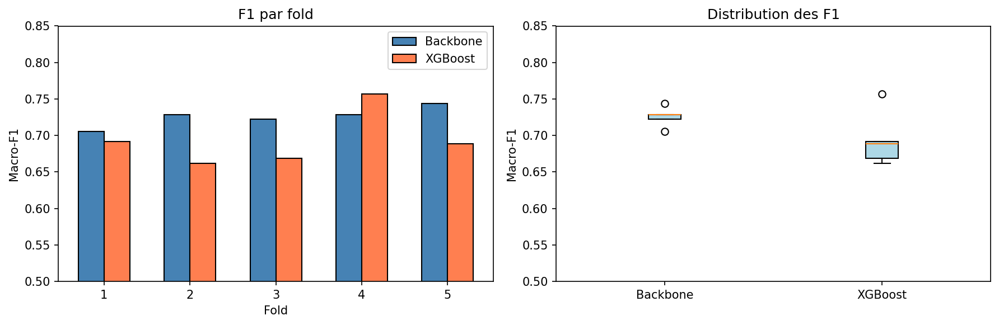

# White blood cell classification

Classification of white blood cells from microscope images into 13 classes, for the IMA205 Kaggle challenge at Télécom Paris (April 2026).

The final pipeline fine-tunes ConvNeXt-Tiny, then trains XGBoost on its embeddings, with 5-fold stratified cross-validation.
On the validation folds, the fine-tuned network reaches a macro-F1 of **0.726 ± 0.014** and XGBoost on its embeddings **0.694 ± 0.038**, against 0.429 for the best classifier on handcrafted features.

**[Read the report](report/report_fr.pdf)** (8 pages, in French)

## The problem

The training set has 28,901 images and is very imbalanced: from 13,015 images of segmented neutrophils (SNE) down to 11 images of prolymphocytes (PLY).
The metric is the macro-F1, so every class weighs the same, and the rare classes decide the score.
Several of them are successive maturation stages of the same cell line (MY, MMY, PMY) and look very much alike.

## Approach

**1. Baseline: handcrafted features** (`01_approche_classique_wbc.ipynb`)

The cell is segmented by Otsu thresholding on the HSV saturation channel, then 35 features are extracted: shape (area, circularity, solidity, asymmetry), color (RGB and HSV statistics on the cell) and texture (GLCM, entropy).
Four classifiers are compared on a stratified 80/20 split:

| Model | Validation macro-F1 | Accuracy |
|---|---:|---:|
| MLP (128, 64) | 0.429 | 0.80 |
| Random Forest | 0.362 | 0.80 |
| Logistic regression | 0.318 | 0.77 |
| SVM (RBF) | 0.302 | 0.79 |

The accuracy looks fine because the large classes are well recognized, but most rare classes are almost never predicted.
This motivated transfer learning.

**2. Deep learning: iterations on a single split**

Each change was tested on the same 80/20 split, and some were also submitted to the Kaggle leaderboard:

| Step | Model and change | Validation macro-F1 | Kaggle |
|---|---|---:|---:|
| V0 | ResNet-18, no rebalancing | 0.680 | |
| V5 | Class-balanced sampler (better than a weighted loss, and than both combined) | 0.635 | |
| V6 | Remove the automatic cell crop: the network uses the context around the cell | 0.680 | |
| V7 | Weight decay 5e-4 | 0.688 | 0.653 |
| V9 | Squeeze-and-Excitation attention (SE-ResNet-18) | 0.650 | **0.674** |
| V10 | Cosine classification head | 0.696 | 0.629 |
| V11 | ConvNeXt-Tiny backbone | 0.676 | |
| V11 | ConvNeXt-Tiny embeddings + XGBoost | 0.673 | |

V5 was run with the cell crop, which explains its lower score; V6 removes it.

The validation score and the leaderboard often disagreed: SE attention gained only 0.005 in validation against its baseline but 0.021 on Kaggle, and the cosine head had the best validation score but the worst submission.
With some classes having only a few images in the validation split, one split was too noisy to choose between models.

**3. Final pipeline: 5-fold cross-validation** (`02_approche_cnn_wbc.ipynb`, `fold_worker.py`)

On each fold:

1. Fine-tune ConvNeXt-Tiny (ImageNet weights) with a class-balanced sampler, AdamW (lr 1e-4, weight decay 5e-4), flips, rotations and color jitter, and early stopping on the validation macro-F1.
2. Extract the 768-dimensional embeddings of the best checkpoint.
3. Train XGBoost on these embeddings.

The test prediction averages the XGBoost probabilities of the 5 folds.
Each fold runs in its own process, so the folds can run in parallel on several GPUs.
The 5 folds took 231 minutes on a single GPU.

## Results



| | Mean macro-F1 | Std | Min | Max |
|---|---:|---:|---:|---:|
| ConvNeXt-Tiny (fine-tuned) | 0.726 | 0.014 | 0.705 | 0.744 |
| XGBoost on its embeddings | 0.694 | 0.038 | 0.662 | 0.757 |

The fine-tuned network alone is better and more stable than XGBoost on its embeddings.
One possible reason is that XGBoost is trained on the embeddings of the images the network was just fine-tuned on, which are better separated than those of unseen images.
The submitted ensemble uses XGBoost, so the better option was not the one submitted.

The remaining errors are on the rare and similar classes: in the best fold, 48 of the 78 BNE images (band neutrophils) are predicted as SNE, their mature form.
PLY is never predicted on the test set.

**Limitations.**
On each fold, the validation set is also used for early stopping of the network and of XGBoost, so these scores are slightly optimistic.
The best leaderboard score during the challenge was 0.674 (V9); the final pipeline was not scored on the leaderboard.

## Usage

The data comes from the [IMA205 Kaggle challenge](https://www.kaggle.com/competitions/ima205-challenge-2026).
Put `train/`, `test/`, `train_metadata.csv` and `test_metadata.csv` next to the notebooks, then:

```bash
pip install -r requirements.txt
```

`01_approche_classique_wbc.ipynb` runs on CPU (about 20 minutes of feature extraction).
`02_approche_cnn_wbc.ipynb` needs a GPU: it launches `fold_worker.py` once per fold, with `NUM_GPUS` folds in parallel.

The notebooks are kept with their outputs.
Code comments and identifiers are in French.
